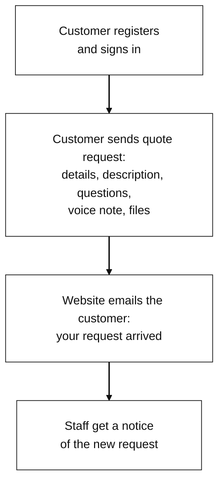
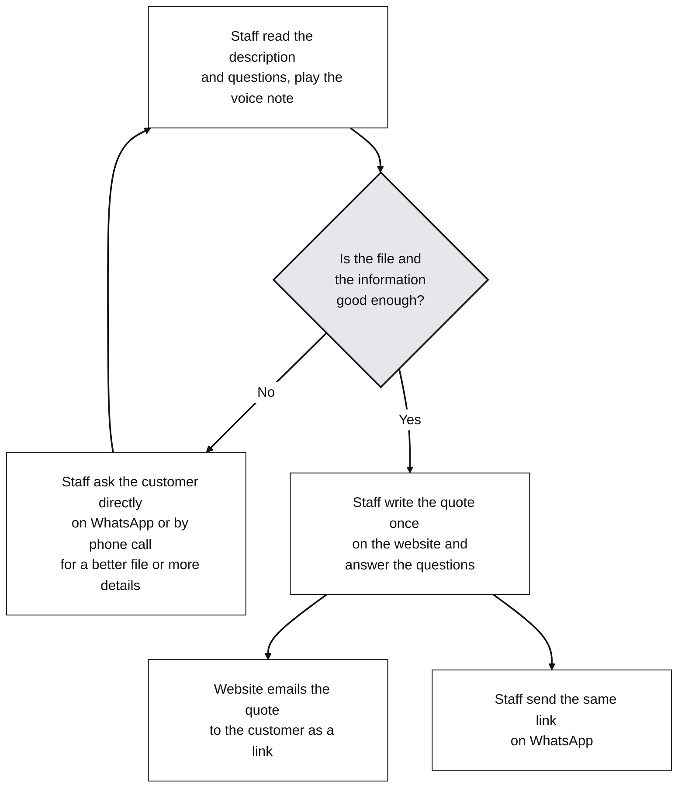
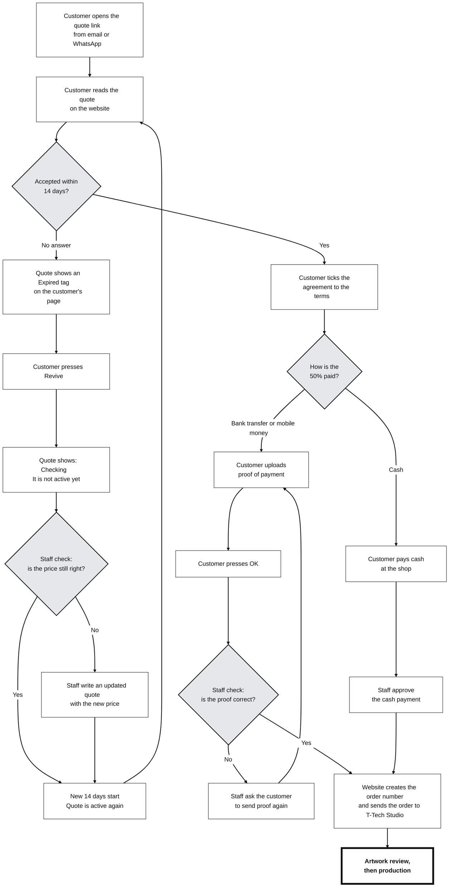
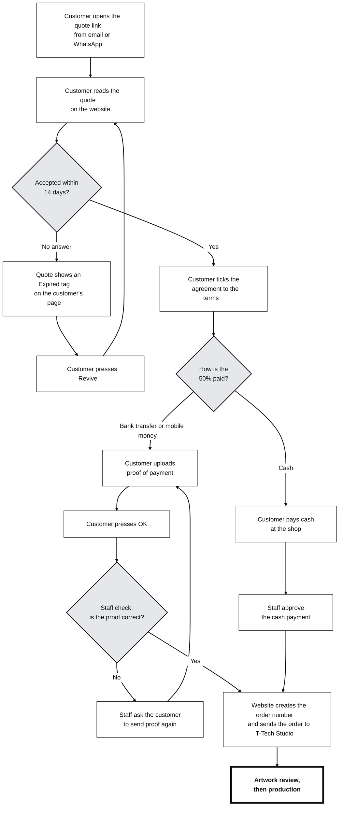
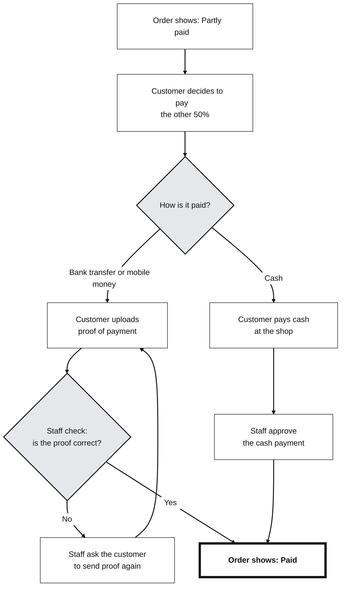

# T-Tech Website: Quote Journey

Plain white boxes, dark text. The journey is split into short drawings so each one stays readable.

_Tip: these drawings use a white background. Use Obsidian's light theme, or the lines may be hard to see in dark mode._

## 1. The customer asks for a quote

## 2. Staff write the quote

## 3. The customer accepts and pays the 50% deposit

## 2. Staff write the quote

## 3. The customer accepts and pays the 50% deposit

## 4. The customer pays the other 50%

The customer can do this at any time.

## 4. The customer pays the other 50%

The customer can do this at any time.

## 5. Questions to check

- When a customer presses Revive, does the quote get a new 14 days? Do staff check the price again before it becomes active?
- Can the customer collect the finished job before the other 50% is paid?