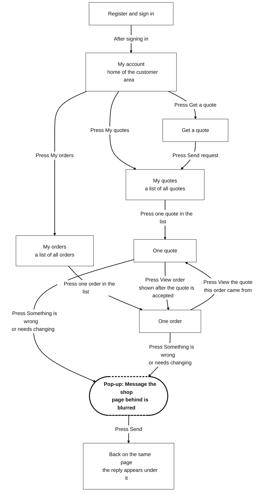
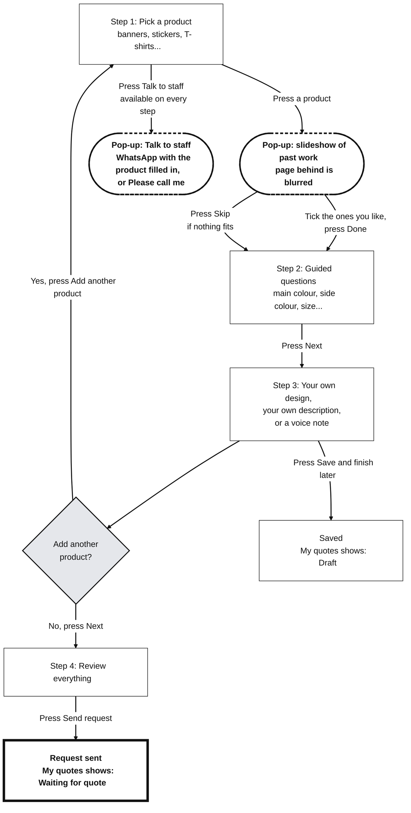
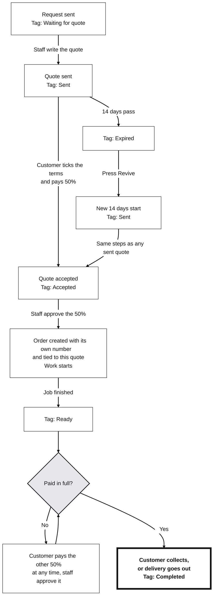
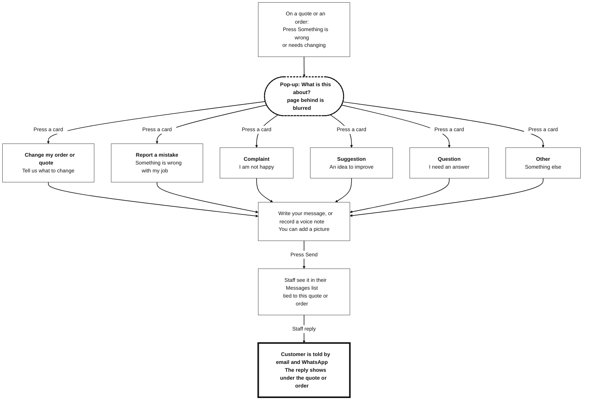

```mermaid
%%{init: {"theme":"base","themeVariables":{"fontSize":"17px","fontFamily":"Arial, sans-serif","primaryColor":"#FFFFFF","primaryTextColor":"#111111","primaryBorderColor":"#111111","lineColor":"#111111","secondaryColor":"#F3F4F6","tertiaryColor":"#FFFFFF","background":"#FFFFFF","edgeLabelBackground":"#FFFFFF","clusterBkg":"#F3F4F6","clusterBorder":"#111111"},"flowchart":{"nodeSpacing":55,"rankSpacing":65,"padding":24,"htmlLabels":true}}}%%
flowchart TD
    R["&nbsp;&nbsp;&nbsp;Request sent&nbsp;&nbsp;&nbsp;<br/>&nbsp;&nbsp;&nbsp;Tag: Waiting for quote&nbsp;&nbsp;&nbsp;"] -- "&nbsp;&nbsp;&nbsp;Staff write the quote&nbsp;&nbsp;&nbsp;" --> Q["&nbsp;&nbsp;&nbsp;Quote sent&nbsp;&nbsp;&nbsp;<br/>&nbsp;&nbsp;&nbsp;Tag: Sent&nbsp;&nbsp;&nbsp;"]
    Q -- "&nbsp;&nbsp;&nbsp;Customer ticks the terms&nbsp;&nbsp;&nbsp;<br/>&nbsp;&nbsp;&nbsp;and pays 50%&nbsp;&nbsp;&nbsp;" --> ACC["&nbsp;&nbsp;&nbsp;Quote accepted&nbsp;&nbsp;&nbsp;<br/>&nbsp;&nbsp;&nbsp;Tag: Accepted&nbsp;&nbsp;&nbsp;"]
    Q -- "&nbsp;&nbsp;&nbsp;14 days pass&nbsp;&nbsp;&nbsp;" --> EXP["&nbsp;&nbsp;&nbsp;Tag: Expired&nbsp;&nbsp;&nbsp;"]
    EXP -- "&nbsp;&nbsp;&nbsp;Press Revive&nbsp;&nbsp;&nbsp;" --> RC["&nbsp;&nbsp;&nbsp;Tag: Checking&nbsp;&nbsp;&nbsp;<br/>&nbsp;&nbsp;&nbsp;Not active yet, cannot be accepted&nbsp;&nbsp;&nbsp;"]
    RC -- "&nbsp;&nbsp;&nbsp;Staff check the price&nbsp;&nbsp;&nbsp;" --> RD{"&nbsp;&nbsp;&nbsp;Is the price&nbsp;&nbsp;&nbsp;<br/>&nbsp;&nbsp;&nbsp;still right?&nbsp;&nbsp;&nbsp;"}
    RD -- "&nbsp;&nbsp;&nbsp;Yes&nbsp;&nbsp;&nbsp;" --> Q2["&nbsp;&nbsp;&nbsp;New 14 days start&nbsp;&nbsp;&nbsp;<br/>&nbsp;&nbsp;&nbsp;Tag: Sent&nbsp;&nbsp;&nbsp;"]
    RD -- "&nbsp;&nbsp;&nbsp;No&nbsp;&nbsp;&nbsp;" --> RN["&nbsp;&nbsp;&nbsp;Staff write an updated quote&nbsp;&nbsp;&nbsp;<br/>&nbsp;&nbsp;&nbsp;with the new price&nbsp;&nbsp;&nbsp;"]
    RN --> Q2
    Q2 -- "&nbsp;&nbsp;&nbsp;Same steps as any sent quote&nbsp;&nbsp;&nbsp;" --> ACC
    ACC -- "&nbsp;&nbsp;&nbsp;Staff approve the 50%&nbsp;&nbsp;&nbsp;" --> ORD["&nbsp;&nbsp;&nbsp;Order created with its own number&nbsp;&nbsp;&nbsp;<br/>&nbsp;&nbsp;&nbsp;and tied to this quote&nbsp;&nbsp;&nbsp;<br/>&nbsp;&nbsp;&nbsp;Work starts&nbsp;&nbsp;&nbsp;"]
    ORD -- "&nbsp;&nbsp;&nbsp;Job finished&nbsp;&nbsp;&nbsp;" --> FIN["&nbsp;&nbsp;&nbsp;Tag: Ready&nbsp;&nbsp;&nbsp;"]
    FIN --> GATE{"&nbsp;&nbsp;&nbsp;Paid in full?&nbsp;&nbsp;&nbsp;"}
    GATE -- "&nbsp;&nbsp;&nbsp;No&nbsp;&nbsp;&nbsp;" --> WAIT["&nbsp;&nbsp;&nbsp;Customer pays the other 50%&nbsp;&nbsp;&nbsp;<br/>&nbsp;&nbsp;&nbsp;at any time, staff approve it&nbsp;&nbsp;&nbsp;"]
    WAIT --> GATE
    GATE -- "&nbsp;&nbsp;&nbsp;Yes&nbsp;&nbsp;&nbsp;" --> COL["&nbsp;&nbsp;&nbsp;Customer collects,&nbsp;&nbsp;&nbsp;<br/>&nbsp;&nbsp;&nbsp;or delivery goes out&nbsp;&nbsp;&nbsp;<br/>&nbsp;&nbsp;&nbsp;Tag: Completed&nbsp;&nbsp;&nbsp;"]
    class GATE,RD decide
    class COL final
    classDef decide fill:#E5E7EB,stroke:#111111,stroke-width:2px,color:#111111
    classDef popup fill:#FFFFFF,stroke:#111111,stroke-width:3px,stroke-dasharray:6 4,color:#111111,font-weight:bold
    classDef final fill:#FFFFFF,stroke:#111111,stroke-width:5px,color:#111111,font-weight:bold
    linkStyle default stroke:#111111,stroke-width:2px
```

# T-Tech Website: Customer Screens

How a signed-in customer moves around. Each arrow says what the customer presses and where it goes.

**How to read the drawings:** a plain box is a screen. A box with a dashed border is a pop-up, with the page behind it blurred. A grey diamond is a decision. A thick border is where something finishes.

_Tip: these drawings use a white background. Use Obsidian's light theme, or the lines may be hard to see in dark mode._

Part of [[00 Page map]].

## 1. Moving between screens

My orders is not a shopping cart. There is no cart at launch. An order only appears after a quote has been accepted and the 50% is paid, so it is a list of jobs. Every order is tied to the quote it came from.

## 2. The quote form, step by step

## 3. From request to finished order

This shows the tags a customer sees on each quote and order.

## 2. The quote form, step by step

## 3. From request to finished order

This shows the tags a customer sees on each quote and order.

## 4. Something is wrong or needs changing

The customer presses one button on any quote or order, picks a card, writes or records a message, and sends it. Staff can also still be reached directly on WhatsApp or by phone call.

## 4. Something is wrong or needs changing

The customer presses one button on any quote or order, picks a card, writes or records a message, and sends it. Staff can also still be reached directly on WhatsApp or by phone call.

## Notes to check

- The customer cannot add or change the price from this message box. If a change affects the price, staff send a new quote.
- Which tags should My quotes and My orders show? The ones in the drawings are my first list.