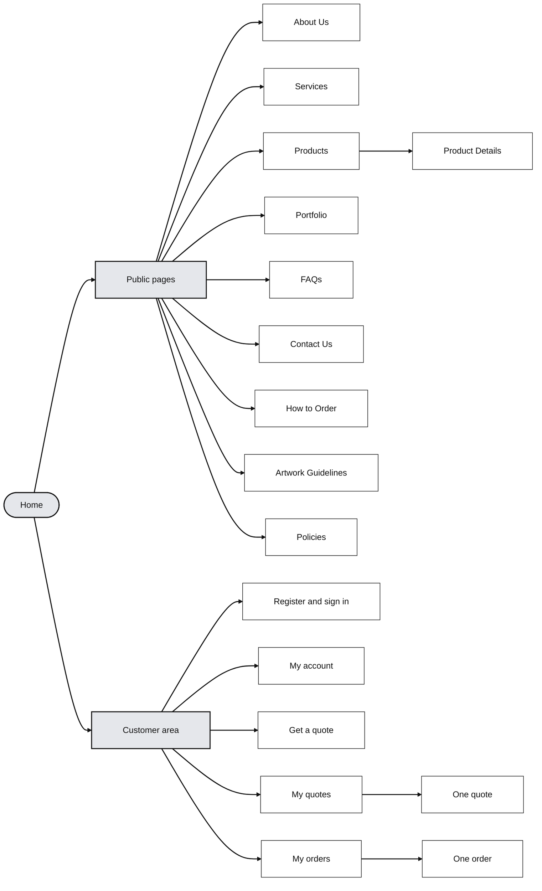

# T-Tech Website: Page Map

Public pages are open to everyone, including signed-in customers. The customer area is only for signed-in customers. Each page name in the outline is a link: click one and Obsidian creates a note for that page, where you can link its sketch.

_Tip: these drawings use a white background. Use Obsidian's light theme, or the lines may be hard to see in dark mode._

## Outline

- Home
    - Public pages (open to everyone)
        - [[About Us]]
        - [[Services]]
        - [[Products]]
            - [[Product Details]]
        - [[Portfolio]]
        - [[FAQs]]
        - [[Contact Us]]
        - [[How to Order]]
        - [[Artwork Guidelines]]
        - [[Policies]]
    - Customer area (signed-in customers only)
        - [[Register and sign in]]
        - [[My account]]
        - [[Get a quote]]
        - [[My quotes]]
            - [[One quote]]
        - [[My orders]]
            - [[One order]]

_"One order" is the Order Tracking page from the requirements document. See [[02 customer screens]] for how these screens connect._

## Drawing

