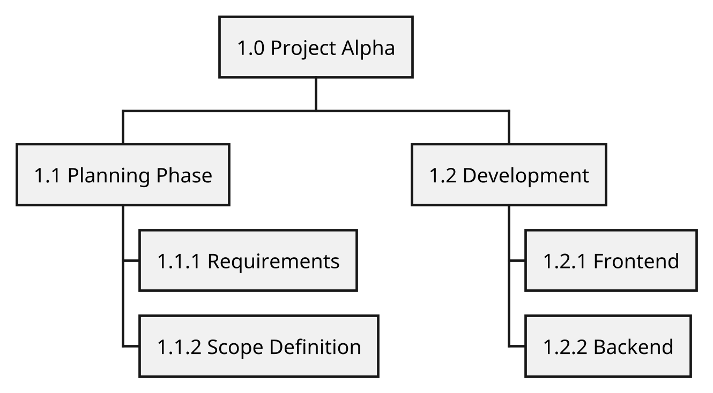
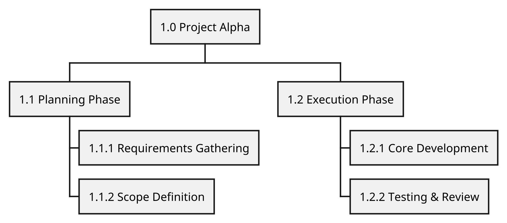

Markdown

```
# PlantUML WBS Setup & Dark/Light Theme Guide for Obsidian

This guide provides step-by-step instructions for setting up **PlantUML** in Obsidian to render Work Breakdown Structure (WBS) diagrams, along with light and dark mode code snippets.
```

## 1. Quick Setup Steps

1. **Install the Plugin:**
    
      
    - Open Obsidian **Settings** (`Ctrl + ,` or `Cmd + ,`).
        
          
        
    - Go to **Community plugins** > **Browse**.
        
          
        
    - Search for **PlantUML**, click **Install**, and then **Enable**.
        
          
        
2. **Configure the Server URL:**
    
      
    - In the PlantUML plugin settings, set the **Server URL** to:
        
        `https://www.plantuml.com/plantuml`
        
          
        
3. **Usage:**
    
      
    - Paste any of the ` ```plantuml ` code blocks below into your Markdown file.
        
          
        
    - Switch your note view from **Editing view** to **Reading view** (or **Live Preview**) to render the diagram.
        
          
        

## 2. Light Mode WBS Themes

### Theme A: Clean Minimalist Light (Crisp White & Black)

A pure, high-contrast light theme with clean lines, white boxes, and sharp text.

  

Markdown

````

````

### Theme B: Modern Light Card (Soft Off-White & Slate)

A modern card design featuring subtle rounded corners, crisp slate borders, and soft backgrounds.

  

Markdown

````

````

## 3. Dark Mode WBS Themes

### Theme C: Modern Dark Card (Dark Slate & Soft White)

Designed specifically for Obsidian dark themes, using dark gray nodes and glowing light-slate branches.

  

Markdown

````

````

## 4. Useful PlantUML WBS Customization Additions

- **High DPI Resolution:** Keep `skinparam dpi 300` right under `@startwbs` to prevent fuzzy images on Retina/High-DPI screens.
    
      
    
- **Boxless Text Nodes:** Add an underscore (`_`) after asterisks to make a specific branch display as plain text without a box:
    
      
    
    Plaintext
    
    ```
    ***_ 1.1.1 Plain text subtask without a card box
    ```
    
- **Multi-line Text:** Wrap node text with `:` and `;` to add line breaks inside a box:
    
      
    
    Plaintext
    
    ```
    ***:Task Name
    Detailed task description line 2;
    ```
    
- **Custom Node Colors:** Override a specific box's background color directly inline:
    
    Plaintext
    
    ```
    ** [ #E74C3C ] Highlighted Phase
    ```